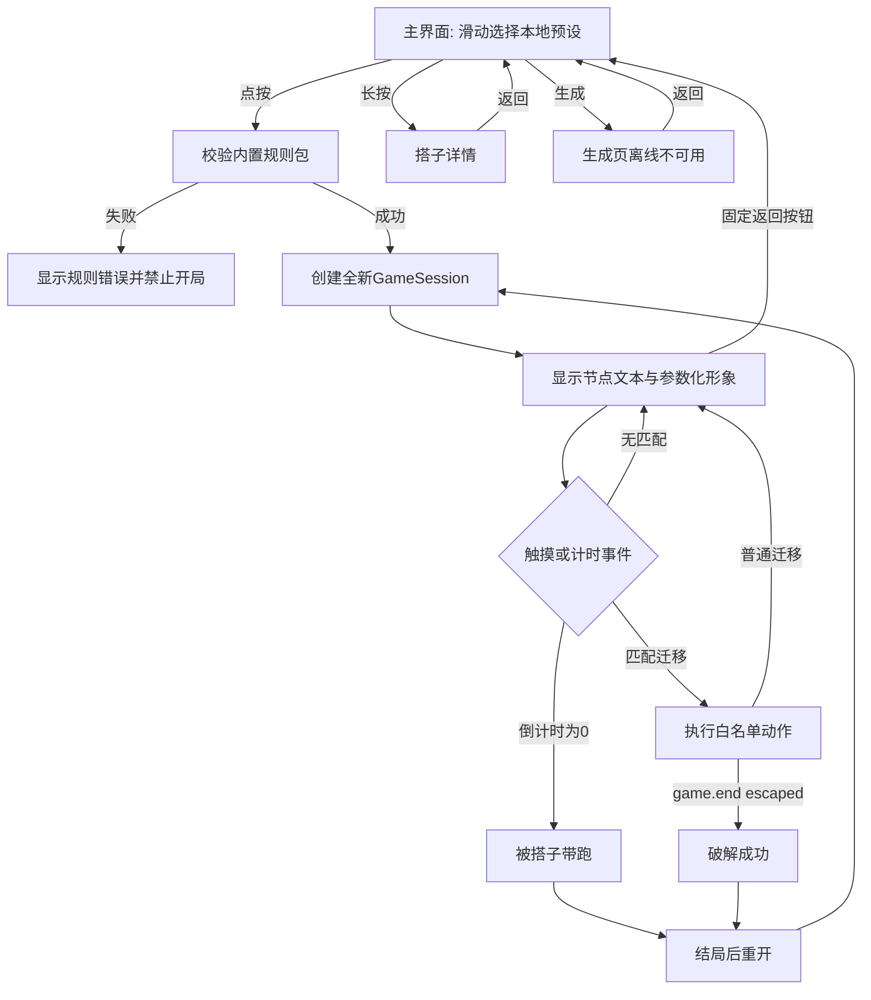

# offline-preset-buddy 设计

## 0. 术语约定

- **搭子 / 预设搭子 / 搭子游戏**：严格使用`.codestable/requirements/CONTEXT.md`定义。
- **规则包v1**：roadmap第4.4节的`BuddyManifest`；本feature只支持离线JSON、白名单事件/动作和编译进固件的资源。
- **本地搭子**：本feature仅包含随固件预置者，不实现服务器下载缓存。
- 检索确认仓库没有既有搭子运行时代码；`archive/initial-directions/`不参与本feature。

## 1. 决策与约束

### 需求摘要

为比赛现场建立不依赖网络的实体游戏闭环：一台T5在主界面滑动选择三只玩法不同的预设搭子，点按进入游戏、长按查看详情；生成页在本阶段显示离线不可用。游戏使用点按、长按、滑动完成60—90秒体验，出现“破解成功”或“被搭子带跑”，固定返回按钮可放弃本局，重开后所有单局变量复位。

成功标准：三只预设均通过静态校验；每只分别执行一次双结局路径，再各做至少3局断网连续重开；显示、触摸和本地音频在真机可观察；主界面、详情、游戏与生成页离线状态导航符合roadmap 4.6；构建和校验命令可重复执行。

### 明确不做

- 不实现麦克风创建、Wi‑Fi、服务器、公共库下载或任何实时联机。
- 不执行动态脚本、任意代码、未知动作或未知枚举。
- 不做长期存档、跨局记忆、账号、外设依赖或AI图片资源。
- 不修改归档原型。

### 关键决策

- 新建`shared/`保存规则包与主机端校验入口，`device/`保存T5运行时；两模块只通过规则包v1耦合。
- 使用roadmap 4.6的三顶级页面导航；本feature实现本地主界面、详情和游戏，生成页只显示离线不可用，不提前实现联网行为。
- 预设搭子编译进固件，开机即可用；首版不依赖Flash文件系统或Micro SD。
- 使用TuyaOpen与LVGL真机链路，不假设Arduino板型支持。
- v1手势作用于整个游戏区域；节点提供`title/instruction`，不引入坐标按钮协议。
- 游戏运行时为单线程状态机；全局倒计时耗尽直接进入默认`carried_away`结局，计时事件先于同一循环内的新触摸事件。
- 复杂度走新嵌入式原型默认档位，无对外SDK或高并发偏离。

### Top 3风险与依赖

1. **T5工具链或外设链路不可用**：第一步先完成官方SDK、显示、触摸、音频spike；失败则阻塞后续，不用模拟器冒充。
2. **规则表达力不足**：三只预设分别使用“拒绝诱惑”“立即行动”“锁定选择”的不同状态与变量路径。
3. **真机计时/触摸导致结局不可达**：主机校验双路径，真机逐只执行双结局与连续重开。

非显然依赖：官方TuyaOpen SDK、CMake≥3.28、Ninja≥1.6、Python venv、CH342驱动。本次环境检测到COM4烧录口、COM8日志口，验收时记录实际端口而非将端口号作为跨机器固定契约。凭证不是本feature依赖。

## 2. 名词与编排

### 2.1 名词层

**现状**：无搭子代码或既有数据结构；只有roadmap第4.4节契约。

**变化**：

- 新增`BuddyManifest`只读模型：内容、参数化形象、变量、节点、资源。
- 新增`GameSession`：当前搭子、当前节点、变量副本、剩余时间、结局；每次开局重新构造。
- 新增`GestureEvent`：`tap | long_press | swipe`，不包含坐标业务语义。
- 新增`ValidationReport`：规则包路径、错误列表；任一错误即不可运行。
- 预设资源使用`builtin://`引用编译进固件的音频，并记录SHA-256与大小；首版不下载外部资源。
- 动画白名单固定为roadmap登记的7种expression与5种motion，校验器和设备共享同一版本。

接口示例：

```text
输入：合法预设 + game.start
输出：GameSession(initial_node, variables=initial, remaining_sec=duration_sec)

输入：touch.long_press且迁移condition满足
输出：执行迁移actions并进入to节点；若action为game.end则保留结局画面

输入：非法schema_version或未知op
输出：ValidationReport含错误；设备不进入游戏
// 来源：roadmap 第4.4节 BuddyManifest
```

### 2.2 编排层



**现状**：无主流程，全新。

**变化**：新增“选择→校验→开局→事件分发→结局→重开”的线性状态机；错误在开局前终止，不将坏包带入运行时。

**流程级约束**：同一时刻仅一个Session；触摸事件按到达顺序处理；结局后忽略游戏手势；固定返回按钮随时放弃本局；重开不读取旧变量；详情返回保留主界面选中项；本feature返回主界面不发生刷新；所有节点文本、变量与资源先校验；日志只记录错误和状态迁移，不记录用户数据。

### 2.3 挂载点清单

- T5应用入口：新增离线搭子启动与预设选择。
- 内置预设注册表：新增三只搭子，删除注册项即卸载对应角色。
- 规则包v1白名单注册表：新增事件/动作/枚举校验与执行映射。
- 真机构建配置：新增T5AI目标及烧录口/日志口记录说明。

### 2.4 推进策略

1. 真机编排骨架：官方SDK构建、烧录、显示/触摸/音频spike。
   退出信号：通过实际烧录口完成烧录，实际日志口看到启动日志，真机可触摸并播放测试音。
2. 共享契约：实现规则包v1校验与三只预设静态样例。
   退出信号：合法包通过，未知op、缺失节点、无双结局和非法时长均失败。
3. 运行时骨架：加载内置包、创建Session、进入初始节点。
   退出信号：三只预设均能在真机显示开局。
4. 游戏状态机：触摸迁移、变量、倒计时、双结局与重开。
   退出信号：主机/真机可分别到达两种结局，重开变量复位。
5. 参数化表演：节点文本、表情、动作和本地音频。
   退出信号：三只预设呈现不同外观与可观察反馈。
6. 真机收口：连续运行、非法输入与断网验证。
   退出信号：每只3局及双结局证据齐全，构建和校验命令重跑通过。

### 2.5 结构健康度与微重构

##### 评估

- 文件级：没有需要修改的现有源码；归档代码不在范围内。
- 目录级：`shared/`与`device/`均为全新目录，无既有文件摊平；compound中无目录组织约定。

##### 结论：不做

绿地模块按职责新建，不需要为搬迁而微重构。

## 3. 验收契约

### 关键场景

1. 断网选择任一预设 → 60—90秒内可完整游玩，无网络请求依赖。
2. 对三只预设分别执行已知破解路径 → 均出现`escaped`。
3. 对三只预设分别接受干扰或等待超时 → 均出现`carried_away`。
4. 结局后重开 → 变量、节点和倒计时恢复初始值。
5. 非法schema、未知op、缺失节点、非法时长或单结局包 → 校验失败且设备不开局。
6. 三只预设分别按脚本执行一次`escaped`和一次`carried_away`，再各做不少于3局连续重开稳定性验证 → 所有路径可到达，显示/触摸/音频可用。
7. 主界面滑动/点按/长按 → 分别切换、进入游戏、查看详情；详情只显示搭子内容、主题标签和本地状态，不显示创造者原话或具体逻辑；详情返回保留选中项，游戏固定返回按钮放弃本局。
8. 离线点击生成 → 显示生成页离线不可用并可返回；不出现麦克风上传或网络请求。
9. 反向核对 → 无服务器/账号/联机/动态代码入口，不修改archive。

### Acceptance Coverage Matrix

| Scenario | Covered By Step | Evidence Type | Command / Action | Core? |
|---|---|---|---|---|
| 合法与非法规则包 | S2 | command | `py -3.12 shared/tools/validate_buddies.py shared/presets`及负例校验 | yes |
| 真机显示/触摸/音频 | S1、S5 | 真机视频与日志 | 记录实际烧录口与日志口 | yes |
| 三只预设双结局 | S4、S6 | 真机视频与验收记录 | 每只执行两条路径 | yes |
| 连续3局与重开重置 | S6 | 真机记录 | 断网连续运行 | yes |
| 三页面、详情与返回导航 | S3、S4、S6 | 真机视频 | 滑动/点按/长按/固定返回/离线生成入口 | yes |
| 无网络/动态代码/联机 | S2、S6 | diff review | 范围与依赖审查 | yes |

### DoD Contract

| ID | 要求 | 证据 | 阻塞级别 |
|---|---|---|---|
| DOD-DESIGN-001 | 设计审查通过 | design-review | blocking |
| DOD-IMPL-001 | 六个步骤完成 | checklist与证据 | blocking |
| DOD-REVIEW-001 | 代码审查无未解决blocking | review报告 | blocking |
| DOD-QA-001 | 核心场景与命令通过 | QA报告 | blocking |
| DOD-ACCEPT-001 | 真机验收与roadmap回写 | acceptance报告 | blocking |

Validation Commands:

| ID | 命令 | 目的 | 核心性 | 失败处理 |
|---|---|---|---|---|
| CMD-001 | `py -3.12 shared/tools/validate_buddies.py shared/presets`（仓库根目录，无第三方依赖） | 校验三只预设 | core | fix-or-block |
| CMD-002 | `cd device/t5 && tos.py build`（已激活TuyaOpen环境并完成T5AI配置） | 构建固件 | core | fix-or-block |
| CMD-003 | `cd device/t5 && tos.py flash`后选择实际A号烧录口 | 烧录真机 | core | fix-or-block |

Required Artifacts：预设包、校验器、T5固件源码、构建说明、真机双结局与连续运行记录、review/QA/acceptance。

清洁度：禁止临时TODO/FIXME、注释掉代码、无用import和调试刷屏；正式错误与状态迁移日志属于功能证据，可以保留。

## 4. 与项目级架构文档的关系

本feature落实roadmap规则包v1与设备运行时，不改变ADR 001。实际支持的动画枚举、资源上限、构建命令和真机限制在验收后回写`attention`或compound；若需修改共享字段，先回roadmap update。
