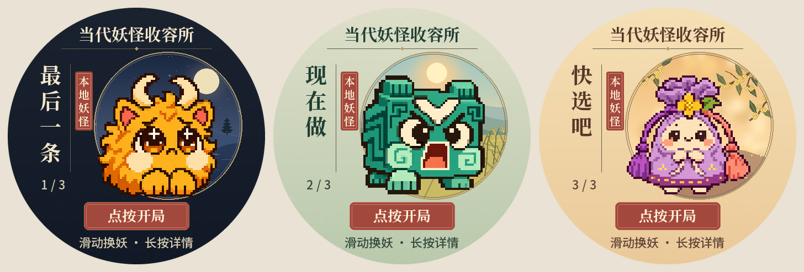

# T5 圆屏界面

## 已烧录到设备的版本

西湖三色背景与居中的 256 像素妖怪，首页显示「当代妖怪收容所」和「本地妖怪」。[选角示意](选角示意.png) · [交互示意](交互示意.png) · [固件及实机验证记录](../../../device/t5/firmware/烧录说明.md)。

## 待审核的设计稿

最新一版沿用收容图鉴的竖排妖名、朱砂印签和圆窗。「最后一条」住在西湖月夜，「现在做」配良渚清晨，「快选吧」配满觉陇的桂花庭院。

此前审核过 [A 收容图鉴](布局审核/A-收容图鉴.png)、[B 月下相遇](布局审核/B-月下相遇.png)、[C 三妖同台](布局审核/C-三妖同台.png)，以及统一夜景的[选角页](布局审核/夜间图鉴-选角.png)和[游玩页](布局审核/夜间图鉴-游玩.png)。
