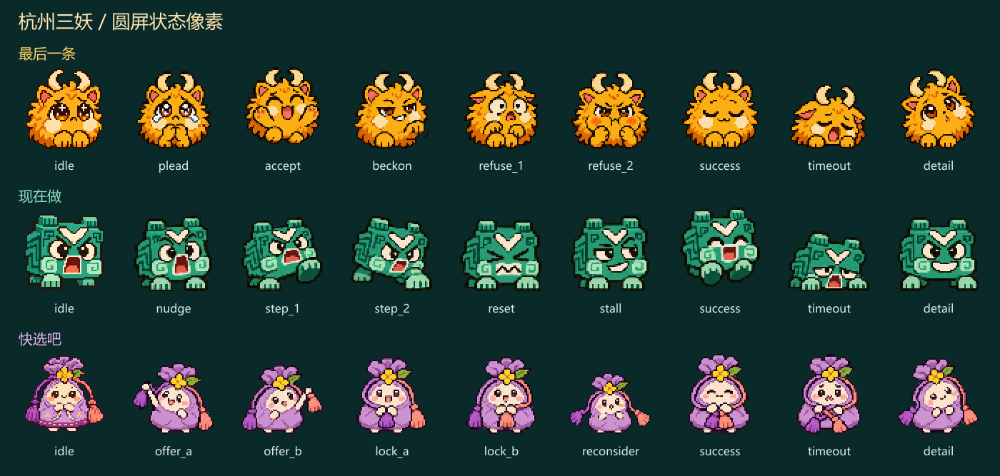

# 杭州三妖｜圆屏状态像素包

27 张独立透明 PNG，每只 9 张，画布均为 64 × 64。三个目录分别对应三个离线预设。选角待机沿用上一版小像，游戏状态按角色重绘。每张都是可以单独保持显示的静态帧。

## 操作对照

### 最后一条 · `last_one`

预设 ID 为 `bdy_preset_last_one`。

| 触发时机 | 图中状态 | PNG |
|---|---|---|
| 选角页停在这只妖怪 | 选角待机 | [idle.png](last_one/idle.png) |
| 开局，进入 invite | 撒娇挽留 | [plead.png](last_one/plead.png) |
| 在 invite 点按，进入 appended | 开心追加 | [accept.png](last_one/accept.png) |
| 在 appended 再点按，回到 invite | 得意招手 | [beckon.png](last_one/beckon.png) |
| 长按后进入 refused，refusals = 1 | 第一次被拒 | [refuse_1.png](last_one/refuse_1.png) |
| 再次长按后仍在 refused，refusals = 2 | 鼓脸生气 | [refuse_2.png](last_one/refuse_2.png) |
| 第三次长按，结局 escaped | 安心睡去 | [success.png](last_one/success.png) |
| 时间耗尽，结局 carried_away | 困得撑不住 | [timeout.png](last_one/timeout.png) |
| 选角页长按打开详情 | 好奇探头 | [detail.png](last_one/detail.png) |

### 现在做 · `do_now`

预设 ID 为 `bdy_preset_do_now`。

| 触发时机 | 图中状态 | PNG |
|---|---|---|
| 选角页停在这只妖怪 | 选角待机 | [idle.png](do_now/idle.png) |
| 开局，进入 nudge | 急着催促 | [nudge.png](do_now/nudge.png) |
| 第一次滑动，进入 acting，actions_done = 1 | 抬脚起步 | [step_1.png](do_now/step_1.png) |
| 第二次滑动，仍在 acting，actions_done = 2 | 向前跨步 | [step_2.png](do_now/step_2.png) |
| 从 acting 点按，回到 nudge，进度清零 | 跺脚重来 | [reset.png](do_now/reset.png) |
| 在 nudge 点按，仍在 nudge | 得意地拖一会儿 | [stall.png](do_now/stall.png) |
| 第三次连续滑动，结局 escaped | 开工跃起 | [success.png](do_now/success.png) |
| 时间耗尽，结局 carried_away | 蔫下来 | [timeout.png](do_now/timeout.png) |
| 选角页长按打开详情 | 昂首得意 | [detail.png](do_now/detail.png) |

### 快选吧 · `decide_now`

预设 ID 为 `bdy_preset_decide_now`。

| 触发时机 | 图中状态 | PNG |
|---|---|---|
| 选角页停在这只妖怪 | 选角待机 | [idle.png](decide_now/idle.png) |
| 开局进入 offer_a，或从 offer_b 点按切回 A | 看向紫穗 A | [offer_a.png](decide_now/offer_a.png) |
| 从 offer_a 点按，进入 offer_b | 看向桃穗 B | [offer_b.png](decide_now/offer_b.png) |
| 从 offer_a 滑动到 locked，记住 A | 抱住紫穗 | [lock_a.png](decide_now/lock_a.png) |
| 从 offer_b 滑动到 locked，记住 B | 抱住桃穗 | [lock_b.png](decide_now/lock_b.png) |
| 在 locked 点按，回到 offer_a；短暂显示此帧再回 offer_a | 松手反悔 | [reconsider.png](decide_now/reconsider.png) |
| 在 locked 再滑动，结局 escaped | 两穗并拢 | [success.png](decide_now/success.png) |
| 时间耗尽，结局 carried_away | 纠结成团 | [timeout.png](decide_now/timeout.png) |
| 选角页长按打开详情 | 歪头等你 | [detail.png](decide_now/detail.png) |

## T5 接入约定

- 在同一位置显示整张 64 × 64 画布，按需要做整数倍最近邻放大。保留透明边缘，不逐帧自动裁边。需要编译进固件时，可将 PNG 转为当前 LVGL v9 工程支持的带透明通道的图像资源。
- 选图时先判断结局，再看手势、跳转前后的节点和操作后的计数。只按节点名选图会漏掉同一节点内的两次拒绝、两次迈步和 A/B 锁定。普通倒计时刷新沿用当前图，无状态变化的手势也沿用当前图。
- 「快选吧」第一次锁定时，记录滑动前的 offer_a 或 offer_b，据此显示紫穗或桃穗。反悔后逻辑已回到 offer_a，可先显示 reconsider 约 300 毫秒再回 offer_a。期间有新操作时，立即取消回切，避免旧帧覆盖新反馈。
- 每局重新开始时清除上局的显示状态，按开局节点选图。时间耗尽显示本角色的 timeout；成功则显示 success，保持到离开结算页。

[对应项目预设](https://github.com/Stoic42/hangzhou-ai-culture-hackathon-2026/tree/3041ee7a7be5d8319ea8c650dcf6e9b3596be099/shared/presets)
