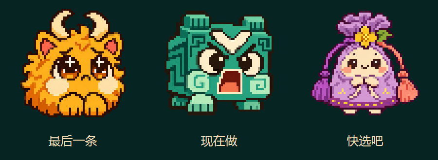
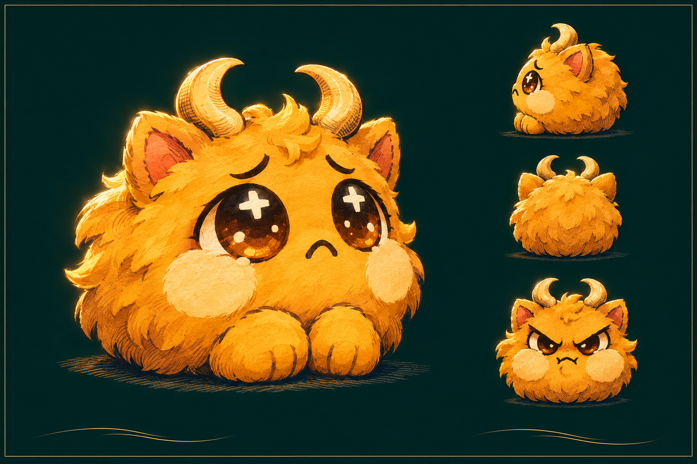
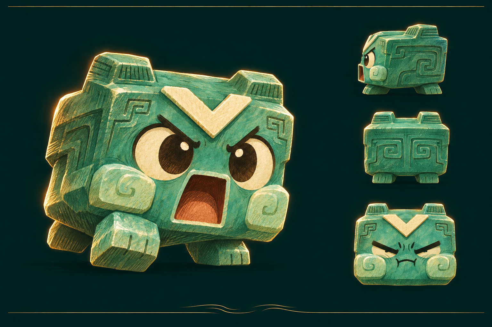
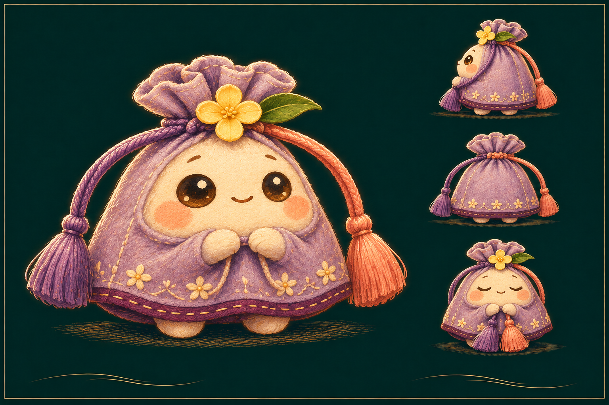

# 当代妖怪收容所｜杭州三妖设定集

三只妖怪分别住在一天里三个很短的瞬间：手指舍不得熄屏，事情迟迟没开头，两个选项来回换。它们把那些手上已经有的动作演给你看。**最后一条**要你留下，所以它伸爪；**现在做**等不得，所以它抬脚；**快选吧**两边都喜欢，所以它一手牵一根绳。

名字和触摸规则沿用[项目的三个离线预设](https://github.com/Stoic42/hangzhou-ai-culture-hackathon-2026/tree/3041ee7a7be5d8319ea8c650dcf6e9b3596be099/shared/presets)。墨绿底、细金线和第一只金兽承接 A 定稿易拉宝。以下物种称呼、身世、造型寓意和动作分镜都是本次原创设定；分镜可供后续制作，交付的 PNG 是静态素材。

## 01｜最后一条 · 捧月绒兽

**「再刷一条，好不好？」** 它怕的不是天亮，是你一关屏，今天就真的过去了。它自己已经困了，却还记得把眼睛睁圆一点，努力显得下一条特别值得看。见到它时，先看那两只并拢的小爪：它比你更舍不得说晚安。

**为什么是一团暖金色的绒球？** 灵感来自西湖三潭印月。同一束光落进水里，好像又多出一轮月亮；「最后一条」也总能变出下一条。于是把夜色留给墨绿底，把本该待在夜空里的月光交给这只兽。圆身、短腿和软毛让它看起来能被捧在手心，也解释了为什么它只会黏着你、不肯自己走开。[杭州政协网：三潭印月与塔中灯影](https://www.hzzx.gov.cn/cshz/content/2020-11/03/content_7845361_0.htm)

| 身上的东西 | 它代表什么，怎样画 |
|---|---|
| 一对向内弯的月牙角 | 像两钩月牙，也像一对小括号，想把今天再多括住一会儿。角要向内，位置高于两侧粉耳；这是海报角色最该保留的剪影。 |
| 深褐大眼、十字亮点 | 那是还没熄掉的屏光。开局把高光画足；安静下来只要眼皮合拢，观众就知道这局结束了。 |
| 奶油色脸颊、并拢前爪 | 两团浅色是盛住月光的位置，也是生气时最先鼓起来的地方。前爪始终靠近身体：撒娇时像请求，发脾气时就像攥紧的小拳头。 |

**在圆屏上怎么演：** 点按答应，它弹一下，又多留你一条。长按拒绝，它把腮鼓圆；第三次长按，前爪松开，眼里的屏光随眼皮落下。结局沿用海报的那句话：「你放下了手机。」**小像保留：双弯角、浅脸颊、两只前爪。** [64 × 64 透明 PNG](像素/最后一条-64.png) · [像素大图](像素/最后一条-大图.png)

## 02｜现在做 · 起步玉方兽

**「先动一下。下一步，等脚落地再说。」** 它长得像桌上最沉、最不该动的一块玉，偏偏是三只里第一个迈腿的。它知道拖延最难的是从零到一，所以只催你迈眼前这一步。

**为什么身体方、眼睛圆？** 轮廓借自良渚玉琮：外方、内圆。在这只兽身上，方形留作稳重的躯干，圆的部分转译成一双瞪大的眼。坚硬的玉身和抢先迈出的短脚形成反差：看似挪不动的事，居然已经动了。它没有照搬礼器的贯孔或神人兽面纹；图中折纹和表情都为游戏原创。[故宫博物院：良渚文化玉琮](https://www.dpm.org.cn/collection/jade/233768.html)

| 身上的东西 | 它代表什么，怎样画 |
|---|---|
| 方肩、顶上两级凸棱 | 像一块有重量的玉，顶角保持平钝。两棱随起跳整块移动，别画成软耳朵。 |
| 额上一道象牙白 V 纹 | 借用任务清单上「勾一下」的动作，把它画成醒目的白折纹。它催的是开工，额纹不是通关奖章，也不是考古纹样。 |
| 侧背转折刻线、前迈的短足 | 刻线转了几个弯还停在原地，短脚却已经跨出去：侧背讲「盘算」，主姿势讲「行动」。 |
| 睁圆的眼、张开的方嘴 | 眼盯眼前一步，方嘴像在喊拍子。身体的主色是青玉绿，眼白和额纹用暖象牙色，让小屏上的脸比刻线更醒目。 |

**在圆屏上怎么演：** 连续滑动三次，分别演成抬脚、移重心、蹬地起跳；中途点按拖延，行动累计清零，两只脚重新落在原处。生气时把嘴抿小、眉毛压低，保留它着急却愿意等你再来一次的性格。**小像保留：方顶、白 V、大嘴、错开的脚。** [64 × 64 透明 PNG](像素/现在做-64.png) · [像素大图](像素/现在做-大图.png)

## 03｜快选吧 · 双穗桂囊

**「两个都舍不得？先替我牵住一根。」** 满觉陇的桂花落了一地，小香囊打算装两朵：这朵香，那朵也香。等它终于挑好，怀里已经满了。它看人的眼神很坦然，因为它并不害怕选错，只是每个选项里，都有一点值得喜欢的东西。

**为什么是香囊？** 杭州秋天寻桂给了它身上的气味和花色；可随身携带、带绣纹和流苏的香囊，给了它一种恰好能演出「选择」的身体结构：同一个袋口伸出两根绳，牵动哪一根，另一边都会跟着动。最后两穗可以合到手心，观众能亲眼看见它定下来了。[杭州网：满觉陇秋日寻桂](https://ori.hangzhou.com.cn/ornews/content/2026-10/09/content_9331319.htm) · [中国丝绸博物馆：织带香囊与馆藏绣囊](https://www.chinasilkmuseum.com/ngcxg/info_11.aspx?itemid=30553)

| 身上的东西 | 它代表什么，怎样画 |
|---|---|
| 上窄下宽的淡紫绸囊 | 圆鼓鼓的下摆说明它什么都想留下；收紧的袋口则让「下定决心」有一个看得见的动作。柔软的绸面要与玉方兽的硬边区分开。 |
| 囊口的一朵四瓣金桂和一片绿叶 | 花固定在绳结上，是两根绳共同的起点。无论选哪边，花都在：放下一个选项，不等于全盘失去。小像里花要画成一个完整的亮色块。 |
| 左紫、右桃的双穗 | 从角色正面看，左手边是紫穗、右手边是桃穗，分别对应 A 与 B。两个颜色没有好坏之分；选中哪边，就让哪根穗先动，而不是让表情判对错。 |
| 米白圆脸、合拢的小手、下摆碎花 | 正眼和微笑留给玩家，小手和穗子负责演犹豫。下摆碎花像一路收下的小念头，只在大图中细画；缩小时让位给双穗。 |

**在圆屏上怎么演：** 点按在 A/B 之间切换，紫穗和桃穗交替荡起。第一次滑动，它握住选中一侧，另一根还轻轻摆；此时点按可以反悔。第二次滑动确认，两穗并在胸前，它合眼笑一下。**小像保留：收口、金桂、不同色的两穗；不要把绳穗画成一对耳朵。** [64 × 64 透明 PNG](像素/快选吧-64.png) · [像素大图](像素/快选吧-大图.png)

## 美术交接

三张设定图均为 **1536 × 1024**。每只各有一张透明像素大图，以及一张 **64 × 64** 的透明 PNG；小图是本版圆屏待机或选角画面的候选素材，显示时用最近邻整数倍缩放。若继续补帧，先守住三个动作：**绒兽收爪、玉兽迈脚、桂囊收绳**。只改眼神而不动这些部位，会丢掉三只妖怪各自的脾气。
